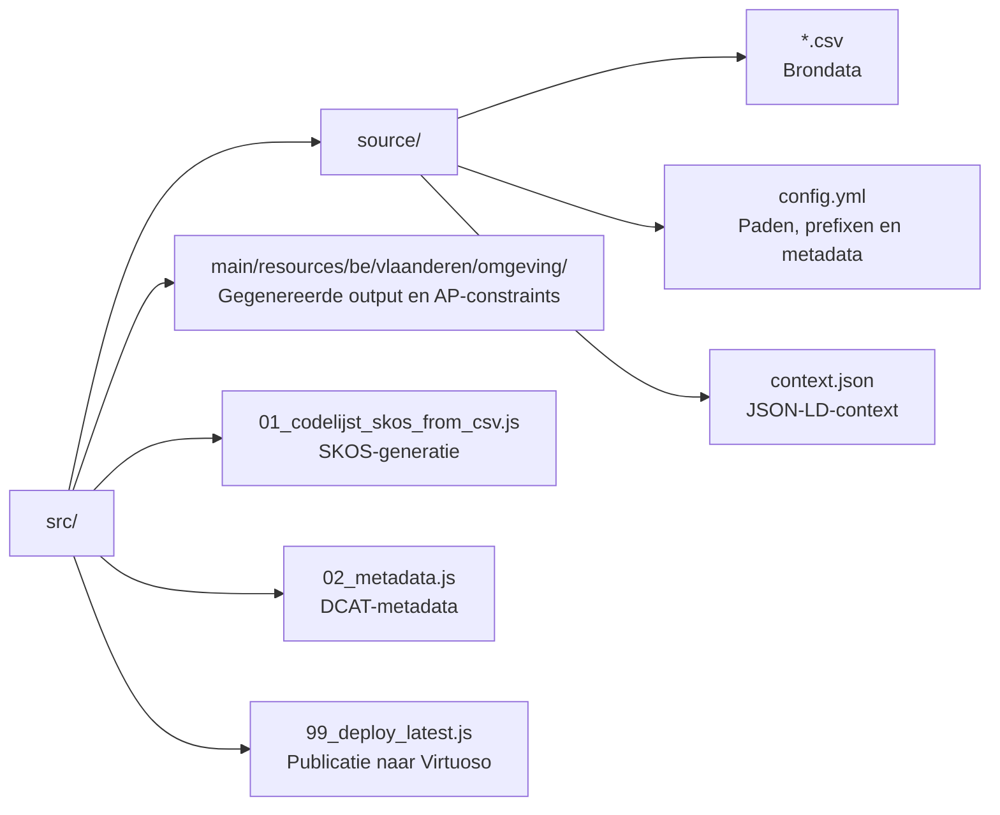
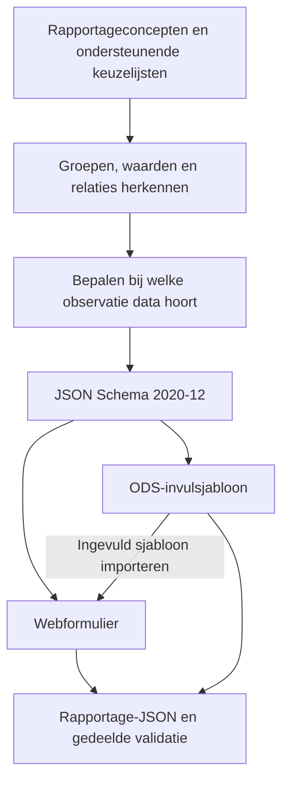

# codelijst-rie-iepr

Codelijsten voor het RIE-IEPR-project (Richtlijn Industriële Emissies / Industrial Emissions Portal Regulation) van het Departement Omgeving, Vlaanderen.

De codelijsten zijn gemodelleerd als [SKOS](https://www.w3.org/TR/skos-reference/) conceptschema's en worden gegenereerd vanuit een CSV-bronbestand. Ze worden gepubliceerd op [data.omgeving.vlaanderen.be](https://data.omgeving.vlaanderen.be).

## Inhoud

De volgende conceptschema's zijn opgenomen (id onder `https://data.omgeving.vlaanderen.be/id/conceptscheme/riepr/`):

**Systeemtypes en -eigenschappen**

| Conceptschema | Beschrijving |
|---|---|
| `systeemtypes` | Overkoepelend schema waar de typeschema's van de systemen deel van uitmaken |
| `systeemeigenschappen` | Overkoepelend schema waar de eigenschappenschema's van de systemen deel van uitmaken |
| `installatietypes` | Soorten installaties (stookinstallatie, GPBV, luchtzuivering, waterzuivering, opslag/overslag, ...) |
| `emissiepunttypes` | Soorten emissiepunten (lozingspunt, emissiepunt lucht, schoorsteen, fakkel, ...) |
| `filtertypes` | Soorten filters (peilfilter, pompfilter, injectiefilter, omkeerbare filter) |
| `meetpunttypes` | Soorten meetpunten (controleinrichting, debietmeter grondwater, peilput) |
| `onttrekkingspunttypes` | Soorten onttrekkingspunten (opnamepunt oppervlaktewater) |
| `uitwisselpunttypes` | Soorten uitwisselpunten (pompput) |
| `installatie-eigenschappen` | Eigenschappen van installaties en de types waarvoor ze gelden |
| `emissiepunteigenschappen` | Eigenschappen van emissiepunten en de types waarvoor ze gelden |
| `filtereigenschappen` | Eigenschappen van filters en de types waarvoor ze gelden |
| `meetpunteigenschappen` | Eigenschappen van meetpunten en de types waarvoor ze gelden |
| `onttrekkingspunteigenschappen` | Eigenschappen van onttrekkingspunten en de types waarvoor ze gelden |
| `uitwisselpunteigenschappen` | Eigenschappen van uitwisselpunten en de types waarvoor ze gelden |

**Selectielijsten van eigenschappen**

| Conceptschema | Beschrijving |
|---|---|
| `installatie_type_stookinstallatie` | Types stookinstallatie (boiler, gasmotor, gasturbine, WKK, ...) |
| `installatie_soort_opgewekte_energie` | Soorten energie die een stookinstallatie kan opwekken |
| `lozingspunt_lozingsplaats` | Plaatsen waar een lozingspunt loost (riool, oppervlaktewater, collector, ...) |
| `meetpunt_referentiepunt_naam` | Referentiepunten voor de hoogtemeting van een peilput |

**Overige vaste gegevens**

| Conceptschema | Beschrijving |
|---|---|
| `aangiftetypes` | Soorten aangiftes (structuur, operationeel) |
| `aangiftestatussen` | Statussen van een aangifte (concept, ingediend, gefaald, ingetrokken) |
| `emissietypes` | Soorten emissies (geleid, niet-geleid, abnormaal, lekverlies, opslagverlies, ...) |
| `proceduretypes` | Soorten procedures in een procesplan (verwerking, transport, emissie, meting, ...) |
| `rubriektypes` | Typering van rubrieken (VLAREM) |
| `statustypes` | Statussen van een entiteit (in dienst, tijdelijk of definitief uit dienst, ontmanteld, ...) |

**Operationele gegevens**

| Conceptschema | Beschrijving |
|---|---|
| `operationeel_<stroom>` en hun stappen (bv. `operationeel_lucht_emissie`) | Stappen en velden van de thematische stromen |
| `operationeel_<lijst>` (bv. `operationeel_peilmethode`) en `herkomst_water` | Selectielijsten voor velden van de operationele gegevens |

De [JSON Schema-POC](poc/poc-json-schema/README.md),
[operationele UI](poc/poc-flow-operationeel/README.md) en
[ODS-POC](poc/poc-json-schema-ods/docs/PROJECT_OUTLINE.md) delen één gegenereerd
rapportagecontract. De **actieve scope is grondwater**: onttrekking/infiltratie,
peilmeting en kwaliteitsmeting. `thematypes.csv` is verwijderd; de generator
begint rechtstreeks bij `conceptscheme:operationeel_grondwater` en parseert geen
andere operationele stromen. Eerdere multi-thema-implementaties en tests zijn
geen garantie dat die stromen in de huidige snapshot worden aangeboden.
Zie [Van CSV naar JSON Schema, UI en ODS](#van-csv-naar-json-schema-ui-en-ods)
voor de transformaties en mappingregels.
Met `npm --prefix poc/poc-json-schema run generate -- --allow-incomplete`
genereer je expliciet alleen de bruikbare doorsneden, met alle blokkeringen in
`schema/index.json` en een waarschuwing bij ODS-sync en -gebruik. Zonder die vlag
blijft onvolledige bronmetadata een fout.

## Uitvoerformaten

De codelijsten worden gegenereerd in de volgende formaten:

- Turtle (`.ttl`)
- JSON-LD (`.jsonld`)
- N-Triples (`.nt`)
- JSON (`.json`)
- CSV (`.csv`)
- Parquet (`.parquet`)
- Excel (`.xlsx`)

## Projectstructuur



## Gebruik

### Vereisten

- Node.js
- Toegang tot `@milieuinfo/maven-metadata-generator-npm`

### Installatie

```bash
pnpm install
```

### Genereren van codelijsten

```bash
node src/01_codelijst_skos_from_csv.js
```

### Genereren van metadata

```bash
node src/02_metadata.js
```

### Publiceren naar de triplestore

```bash
node src/99_deploy_latest.js
```

## Configuratie

De configuratie staat in `src/source/config.yml`. Hierin worden onder andere de outputpaden, prefixen, DCAT-metadata en de Virtuoso-connectie ingesteld.

Verbindingsgegevens voor de Virtuoso-triplestore worden ingelezen vanuit een `.env`-bestand (niet ingecheckt in de repository).

### Codelijst-prefixen (CURIEs)

Concepten worden in de bron-CSVs aangeduid met een korte prefix gevolgd door de code,
bv. `installatie:stookinstallatie` of `installatie-eigenschappen:nominaal_thermisch_vermogen`.
De prefixen zijn bewust kort en herkenbaar gehouden: de naam van de codelijst zonder
technische voor- of achtervoegsels (`riepr-`, `-type`, `operationeel-`).

Nieuwe prefixen worden gedeclareerd bovenaan het `prefixes:`-blok in `src/source/config.yml`;
een prefix die in een CSV gebruikt wordt maar daar niet gedeclareerd is, laat `pnpm run generate_skos` falen.
De onderliggende URIs zijn ongewijzigd — enkel de korte naam verandert, dus gepubliceerde
identificatoren blijven geldig.

| Prefix | Codelijst (pad onder `.../id/concept/riepr/`) |
| --- | --- |
| `aangifte:` | `aangiftetype/` |
| `aangiftestatus:` | `aangiftestatus/` |
| `bandbreedte:` | `norm_bandbreedte/` |
| `bepalingsmethode:` | `operationeel-bepalingsmethode/` |
| `bepalingsmethodeclassificatie:` | `operationeel-bepalingsmethodeclassificatie/` |
| `bestemming:` | `operationeel-bestemmingstype/` |
| `contextueel:` | `operationeel-contextueel/` |
| `debiet:` | `operationeel-debiettype/` |
| `emissie:` | `emissietype/` |
| `emissiepunt:` | `emissiepunttype/` |
| `emissiepunteigenschappen:` | `emissiepunteigenschappen/` |
| `emissiepunt-selectiemogelijkheden:` | `emissiepunteigenschappen-selectiemogelijkheden/` |
| `filter:` | `filtertype/` |
| `grondstoffen:` | `operationeel-grondstoffen/` |
| `grondwater:` | `operationeel-grondwater/` |
| `installatie:` | `installatietype/` |
| `installatie-eigenschappen:` | `installatie-eigenschappen/` |
| `installatie-selectiemogelijkheden:` | `installatie-eigenschappen-selectiemogelijkheden/` |
| `lozingsplaats:` | `lozingspunt-lozingsplaats/` |
| `lucht:` | `operationeel-lucht/` |
| `meetfrequentie:` | `operationeel-meetfrequentie/` |
| `meetinstrument:` | `meetinstrumenttype/` |
| `meetpunt:` | `meetpunttype/` |
| `meetpunteigenschappen:` | `meetpunteigenschappen/` |
| `meetpunt-selectiemogelijkheden:` | `meetpunteigenschappen-selectiemogelijkheden/` |
| `onttrekkingspunt:` | `onttrekkingspunttype/` |
| `onttrekkingspunteigenschappen:` | `onttrekkingspunteigenschappen/` |
| `peilmethode:` | `operationeel-peilmethode/` |
| `pomptoestand:` | `operationeel-pomptoestand/` |
| `procedure:` | `proceduretype/` |
| `procesvariabele:` | `procesvariabeletype/` |
| `rubriek:` | `rubriektype/` |
| `statustype:` | `statustype/` |
| `techniekmonstername:` | `operationeel-techniekmonstername/` |
| `thema:` | `thematype/` |
| `toepassingswijze:` | `operationeel-toepassingswijze/` |
| `toestand-indicator:` | `operationeel-toestand-indicator/` |
| `uitwisselpunt:` | `uitwisselpunttype/` |
| `uitwisselpunteigenschappen:` | `uitwisselpunteigenschappen/` |
| `water:` | `operationeel-water/` |
| `zelfcontrole-lucht:` | `operationeel-zelfcontrole-lucht/` |
| `zelfcontrole-water:` | `operationeel-zelfcontrole-water/` |

> `statustype:` heet niet `status:` omdat `status` al een term is in `context.json` (`adms:status`).

## Interpretatie
Deze sectie bevat informatie over de interpretatie van de codelijsten.

### Structurele gegevens
Structurele gegevens zijn opgedeeld in meerdere CSV bestanden voor de verschillende structurele types in het datamodel. Met name, emissiepunten, installaties, filters, meetpunten, meetinstrumenten en uitwisselpunten. Elk van deze types heeft een eigen CSV-bestand voor de relevante eigenschappen die de vaste attributen van het datamodel aanvullen.

#### Types en eigenschappen
Elk systeem (`emissiepunt`, `filter`, `installatie`, `meetpunt`, `uitwisselpunt`, `onttrekkingspunt`) heeft twee codelijsten:
- `<systeem>types.csv`: de soorten van dat systeem, als hiërarchie via `broader` (bv. `emissiepunt:schoorsteen` is een `emissiepunt:emissiepunt_lucht`). `isOnzichtbaar = true` verbergt een type voor selectie (bv. omdat het enkel een structurele groepering is); de subtypes blijven wel selecteerbaar en erven de eigenschappen. `isMeetbaar = true` geeft aan dat het systeemtype meetbaar is.
- `<systeem>eigenschappen.csv`: de systeemeigenschappen die de vaste attributen uit het datamodel (`riepr.ttl`: naam, beschrijving, ...) aanvullen. De vaste attributen staan dus niet in de CSV's.

De bestandsnaam is het id van het conceptschema (bv. `emissiepunttypes.csv`, `emissiepunteigenschappen.csv`). Uitzondering: `installatie-eigenschappen.csv` (koppelteken bij klinkerbotsing).

#### Welke eigenschappen gelden voor welk type?
`relevantRiepr` op een eigenschap bepaalt voor welke types ze geldt. De waarde bevat één of meer types, gescheiden door `|` of `,`.

1. **Direct**: de eigenschap geldt voor elk type dat in `relevantRiepr` staat.
2. **Overerving**: ze geldt ook voor alle subtypes van die types (`broader`-keten). Een eigenschap op `emissiepunt:emissiepunt_lucht` geldt dus ook voor `emissiepunt:schoorsteen`. Een eigenschap die enkel op een subtype staat, geldt niet voor het bovenliggende type.
3. **Alle types**: de waarde `conceptscheme:<systeem>types` (bv. `conceptscheme:installatietypes`) betekent alle types van dat systeem.
4. **Leeg**: een eigenschap zonder `relevantRiepr` geldt voor **geen enkel type**. Dit is dus niet "alles". Enige uitzondering zijn onderdelen van een composite (zie hieronder).
5. **Onzichtbare types**: `isOnzichtbaar` beïnvloedt enkel of een type gekozen kan worden, niet welke eigenschappen het erft of doorgeeft.

##### Composite eigenschappen
Een composite eigenschap bestaat uit een ouder en onderdelen die naar de ouder verwijzen via `broaderPartitive`. De ouder heeft zelf geen waarde, de onderdelen vormen samen één invulbare groep.
- De ouder en onderdelen worden als één geheel getoond. Het type waarvoor de groep geldt, mag op de ouder, op de onderdelen of op beide staan; de scope van de groep is de unie van al die waarden. Een onderdeel zonder eigen `relevantRiepr` erft de scope van de groep en wordt nooit apart gefilterd.
- Voorbeelden uit de data:

| Composite | `relevantRiepr` op de ouder | `relevantRiepr` op de onderdelen |
|---|---|---|
| `installatie-eigenschappen:verwijderingsrendement` | leeg | `_stof`: `installatie:luchtzuivering`, `_percentage`: leeg |
| `meetpunteigenschappen:referentiepunt` | leeg | `_naam` en `_diepte`: `meetpunt:peilput` |

- Een composite waarvan noch de ouder, noch een onderdeel een `relevantRiepr` heeft, geldt voor geen enkel type en wordt als fout gerapporteerd.
- `isMeervoudig` op de ouder maakt de hele groep herhaalbaar: elke rij bevat alle onderdelen. Is de ouder ook `isVerplicht`, dan start de groep met één rij; anders is er enkel een knop om een rij toe te voegen.

##### Waardebepaling van een onderdeel
- `relevantDataType` bepaalt het type invoer (`xsd:decimal`, `xsd:integer`, ...). Zonder datatype en zonder lijst is het een vrije tekst.
- `relevantUnit` verwijst naar één CSOR-eenheid (`csor_eenheid:E_59`) of naar een `collectie:*` met meerdere eenheden waaruit gekozen wordt.
- `relevantCodeList` verwijst naar een lijst om uit te kiezen: een `conceptscheme:*` in dezelfde CSV (selectiemogelijkheden) of een `collectie:*` met CSOR-concepten (bv. stoffen). Labels en definities van CSOR-concepten komen uit de publieke lijsten [codelijst-csor-eenheid](https://github.com/milieuinfo/codelijst-csor-eenheid) en [codelijst-csor-variabele](https://github.com/milieuinfo/codelijst-csor-variabele).

> De MCP-server (`mcp/`) past exact deze regels toe in `get_type_properties`, `get_property` en `validate_codelists`.


### Operationele gegevens
Operationele gegevens beschrijven rapportagegroepen, velden en hun betekenis.
De voorbeelden van andere stromen hieronder beschrijven het bredere model;
de huidige POCs verwerken alleen grondwater. De algemene bouwstenen zijn:
- `skos:ConceptScheme` voor elk scherm/stap dat we aan de gebruiker willen tonen
- `vervolgstap` (`qb:codeList`) is een link tussen een concept en concept scheme en bepaalt welke stap volgt
- `conditionPath`/`conditionValue` bepalen dat een concept getoond mag worden indien het concept op het pad (`conditionPath`) een bepaalde waarde (`conditionValue`) heeft
- `relevantDataType` bepaald het data type van een concept. `xsd:*` en `dcterms:*` zijn mogelijke data types
- `broaderPartitive` verwijst van een onderdeel naar zijn composite ouder
- `related` (`skos:related`) verbindt alternatieve varianten. De schemagenerator bewaart ze als afzonderlijke, conditionele properties met `x-related-concepts`; hij voegt geen gelijknamige velden van verschillende varianten samen
- `isMeervoudig` bepaald dat iets meerdere keren kan toegevoegd worden
    - een meervoudig concept dat ook verplicht is wordt standaard al 1 weergegeven (met composite concepten indien `hasPart` relatie bestaat), anders is het een knop om dit toe te voegen
- `isMultiselect` geeft aan (bij gebruikt `relevantCodeList` of `relevantRiepr` of `relevantUnit`) waarbij er een selectie gemaakt moet worden dat er meerdere items geselecteerd kunnen worden
- `isVerplicht` bepaald dat een veld verplicht is
- `isOnzichtbaar` verbergt structurele invoer/groepslabels, niet noodzakelijk de onderdelen: het onzichtbare labo blijft bijvoorbeeld een getypeerd object met een zichtbaar naamveld
- `isMeetbaar` geeft aan dat een systeemtype meetbaar is; voor de systeemtype-codelijsten wordt deze expliciet op `true` gezet
- `relevantCodeList` verwijst naar een `skos:ConceptScheme` of `skos:Collection` met selecteerbare waarden
- `relevantUnit` geeft aan dat een veld (hoogstwaarschijnlijk een numeriek veld) een bepaalde eenheid heeft. Het kan echter ook verwijzen naar een `skos:ConceptScheme` met lijst van eenheden zodat er een selectie gemaakt moet worden
- `minValue` en `maxValue` begrenzen de waarde van een numeriek veld (`xsd:decimal`/`xsd:integer`): ze publiceren als `schema.org/minValue` en `schema.org/maxValue` en zijn beide optioneel
- `relevantClass` geeft aan naar welke classe een concept gemapped moet worden. Bijvoorbeeld naar observatie, feature of interest, ...
    - De klasse komt uit de bron, niet uit de positie: peilmeting is `riepr:Observatie`; onttrekking en kwaliteitsmeting zijn `riepr:ObservatieVerzameling`. Lid-observaties worden via `sosa:hasMember` gekoppeld
- `relation` bepaalt het RDF-predicaat; `relevantObservation` bepaalt aan welke observatie(s) of verzameling het gegeven toebehoort, onafhankelijk van de presentatiegroep
- `_table_workbook` en `_table_sheet` bepalen de ODS-bestandsnaam en het werkblad; ze veranderen de semantische eigenaar niet
- `relevantRiepr` geeft aan dat een selectie gemaakt moet worden van systemen/processen/... die actief waren in het productiejaar. In het geval dit start met `riepr:*` zoeken we op alle instanties van een concept (Installatie, Emisisepunt, ...). In het geval het start met een concept dan geven we aan dat het alle (sub)types zijn.
    - :warning: **Belangrijk:**

#### Thematische stroom
1. De gebruiker kiest een productiejaar. Dit begrenst de structurele referenties en hun validatiecontext; de POC maakt hiervan niet automatisch een `sosa:phenomenonTime`.
2. De huidige UI leest thema's en doorsneden uit `schema/index.json`, niet uit `thematypes.csv`. Het grondwater-conceptschema is het expliciete startpunt van de generator.
3. In het eerdere multi-thema-model verbonden `vervolgstap`-relaties (`qb:codeList`) thema's en stappen. Die navigatie blijft modelinformatie, maar is niet het startmechanisme van het actieve grondwaterprofiel.

> De bedoeling is dat de applicatie zo weinig mogelijk logica omvat voor zowel UI als data ophalen/bewaren voor de thematische stromen. Zo kunnen a.h.v. deze codelijsten alle business regels worden bijgesteld waar nodig zonder al te grote wijzigingen te vereisen.

#### Contextueel
4.  De contextuele stroom `conceptscheme:operationeel_contextueel` vereist eerst dat je een GPBV installatie selecteerd (`relevantClass` = `sosa:FeatureOfInterest`)
5.  Vervolgens kan je hierop grondstoffen, energieverbruik, etc.. rapporteren
6.  Men kan na het selecteren van de GPBV installatie ook individueel rapporteren op de activiteiten van de GPBV installatie (`riepr:Rubriek`). We weten dat we rubrieken zoeken binnenin de GPBV installatie omdat ook hier `relevantClass` = `sosa:FeatureOfInterest` en we dus een genest feature of interest zoeken
7.  Rapportering op activiteit bevat bijvoorbeeld het productievolume

#### Grondstoffen
4.  De grondstoffen stroom `conceptscheme:operationeel_grondstoffen` vereist eerst dat je eenvinkt of je grondstoffen hebt geproduceerd (`grondstoffen:geproduceerd`)
5.  Het toevoegen/rapporteren van grondstoffen (`grondstoffen:grondstof`) is een meervoudige composite concept (via `hasPart`) dat enkel toont als `grondstoffen:geproduceerd` = `true` (a.h.v. `conditionPath`/`conditionValue`)
6.  Elementen die selecties uit een codelijst vereisen zoals toepassingswijze refereren naar een andere `skos:ConceptScheme`
7.  De bestemmingsidentificatie van een grondstof is één logische groep die bestaat uit vier gerelateerde varianten (`related`): Belgische vestiging, buitenlandse vestiging, geen onderneming en werf. Afhankelijk van de gekozen `grondstof_bestemming_type` toont de applicatie één "Bestemmingsidentificatie"-groep met de juiste velden (naam, ondernemings-/vestigingsnummer, BTW-nummer of adres)

#### Grondwater
4.  De stroom grondwater `conceptscheme:operationeel_grondwater` vereist eerst dat je specifieert welke meting je wil uitvoeren; kwaliteitsmeting, peilmeting of onttrekking/infiltratie. Dit zijn `skos:Concept`en die meervoudig zijn en via de `hasPart` relatie opgedeeld in de gevraagde gegevens
5.  Bijvoorbeeld. Peilmeting heeft een `relevantRiepr` met `filter:peil,filter:pomp`. In de JSON(-LD) zal dit als twee relaties komen te staan waardoor we dus zowel alle peil- en pompputten willen weergeven.

#### Lucht
4.  De stroom lucht `conceptscheme:operationeel_lucht` vereist als eerste stap dat je een emissiepunt (voor lucht) selecteerd
5.  Vervolgens moet je als multiselect bronnen selecteren (`riepr:Installatie`) verbonden met het emissiepunt. We weten dat we niet alle installaties zoeken omdat bij de selectie van het emissiepunt we als `relevantClass` = `sosa:FeatureOfInterest` hebben en dus binnen deze feature moeten zoeken
6.  Onderliggende rapportering zoals `lucht:brandstof` wordt op de bron+emissiepunt combinatie uitgevoerd en zijn composite concepten

## Van CSV naar JSON Schema, UI en ODS

### Eén contract, twee presentaties

De JSON Schema-generator bepaalt de **datastructuur en validatieregels**.
De UI en de ODS-generator interpreteren datzelfde contract; ze leiden niet elk
opnieuw de rapportagestructuur af uit RDF. RDF/CSOR blijven wel nodig voor labels
en keuzelijsten. De voorbeelden onder `analyse/` zijn een referentie voor de
ODS-presentatie, geen bron waaruit de applicatie regels of bedrijfsdata kopieert.



Lees de kolommen in deze volgorde:

| Vraag | Te lezen kolommen |
|---|---|
| Over welk rapportageonderdeel gaat dit? | `inScheme`, `broaderPartitive` |
| Is dit een groep, observatie of invulbare waarde? | `relevantClass`, `relevantDataType`, onderdelen via `broaderPartitive` |
| Bij wie hoort de waarde en wat betekent de koppeling? | `relevantObservation`, `relation` |
| Welke waarden mag de gebruiker invullen? | `relevantDataType`, `relevantCodeList`, `relevantRiepr`, `relevantUnit`, `minValue`, `maxValue` |
| Hoe vaak en wanneer moet dit ingevuld worden? | `isMeervoudig`, `isMultiselect`, `isVerplicht`, `conditionPath`, `conditionValue` |
| Hoe wordt het getoond? | `prefLabel`, `definition`, `isOnzichtbaar`, `_ui_first`, `_ui_after`, `_table_workbook`, `_table_sheet` |

### 1. Rapportagegroepen en onderdelen herkennen

De huidige scope is `conceptscheme:operationeel_grondwater`.
De ondersteunende lijsten leveren keuzes zoals detectiegrensindicatoren,
geen extra rapportagegroepen. Andere operationele stromen worden niet verwerkt.

Begin bij de drie zelfstandige rapportagegroepen: onttrekking, peilmeting en
kwaliteitsmeting. Voor elke groep ontstaat een afzonderlijk JSON-schema.
De bijbehorende `_table_workbook`-waarden verdelen de invoer over drie
ODS-bestanden.

Zoek vervolgens alle onderdelen die via `broaderPartitive` naar een groep
verwijzen. Herhaal dit voor hun onderdelen. Zo ontstaat een geneste structuur:
een groep wordt een object, haar onderdelen worden properties van dat object.
`topConceptOf` alleen volstaat niet om de ouder-kindstructuur te bepalen.
Een werkbladgrens verandert die structuur niet: gegevens op verschillende
werkbladen kunnen nog steeds bij dezelfde rapportage horen.

### 2. Van concept naar JSON-property

Vertaal de kolommen van ieder concept naar onderstaande schemaregels.
Pas daarna de regels voor observatie-eigenaarschap toe: die kunnen bepalen
dat een property binnen een observatie of haar resultaat moet staan.

| Bronmetadata | JSON Schema / mapping | Gevolg voor de invoer |
|---|---|---|
| `prefLabel`, `definition` | `title`, `description` | Bronlabel als kolomkop/veldlabel; geen technisch propertypad als label |
| `relation` | Propertynaam uit de lokale naam van het predicaat; volledige URI in `x-jsonld-id` | `schema:measurementMethod` wordt `measurementMethod` |
| `relevantClass` | `x-jsonld-type` op het object | Klasse bewaren zonder een invoerveld voor de klasse te tonen |
| `relevantFeatureClass` | `x-feature-mapping` | Invoer voor later te construeren feature; geen extra feature-object verzinnen |
| `relevantDataType` | `type` en waar nodig `format` | Tekst, getal, boolean, datum, datum-tijd of duur |
| `broaderPartitive` | Geneste `properties` | Singleton details worden kolommen binnen dezelfde rij |
| `relevantObservation` | Property onder de aangewezen observatie of verzameling | De presentatiegroep hoeft niet de data-eigenaar te zijn |
| `isMeervoudig` | `type: array` met `items` | Herhaalbare records |
| `isMultiselect` | Array van selectiewaarden | Meerdere referenties/keuzes, geen herhaalbaar volledig record |
| `isVerplicht` | `required`; bij verplichte arrays ook `minItems: 1`; bij predicaatlijsten `contains`/`minContains` op `observedProperty` of `propertyID` | Validatie-eis, niet automatisch een ingevuld record |
| `relevantCodeList` | `enum` met volledige concept-URI's | Labels tonen, URI's bewaren |
| `relevantRiepr` | `x-reference-types` | Kiezen uit instanties van de gevraagde structurele types |
| `relevantUnit` | `const` of `enum` op `hasUnit`/`unitCode` | Vast symbool of selecteerbare eenheid |
| `minValue`, `maxValue` | `minimum`, `maximum` | Numerieke grenzen |
| `_table_workbook`, `_table_sheet` | `x-table-workbook`, `x-table-sheet` | Bestands- en werkbladindeling |
| `_ui_first`, `_ui_after` | Volgordeannotaties en afgeleid `x-table-order` | De volgorde behouden, ook wanneer semantische hergroepering nodig is |
| `isOnzichtbaar` | Verborgen invoer of structurele container | Zichtbare onderdelen blijven invulbaar; hun objectstructuur blijft bewaard |

`xsd:decimal` wordt `number`, `xsd:integer` wordt `integer`,
`xsd:boolean` wordt `boolean`; `xsd:date`, `xsd:dateTime` en `xsd:duration`
worden strings met respectievelijk `date`, `date-time` en `duration`.
`dcterms:temporal` kan een periodeobject met `start`/`end` worden.
Objecten zijn gesloten met `additionalProperties: false`.

Bijvoorbeeld: een concept met label **Analysemethode**, relatie
`schema:measurementMethod`, datatype `xsd:string` en `isVerplicht = true`
wordt binnen zijn eigenaar:

```json
{
  "type": "object",
  "properties": {
    "measurementMethod": {
      "title": "Analysemethode",
      "type": "string",
      "x-jsonld-id": "https://schema.org/measurementMethod"
    }
  },
  "required": ["measurementMethod"],
  "additionalProperties": false
}
```

Dit is een vereenvoudigd mappingvoorbeeld, geen verklaring dat
Analysemethode in de huidige bron verplicht is. Zonder `isVerplicht` komt
de property niet in `required`. Met `isMeervoudig` wordt de waarde omgeven
door een array met `items`; een verplichte array krijgt `minItems: 1`.

**Iedere data-eigenschap heeft een relatie.** Een klasse zoals `prov:Agent`
zegt wat het object is, maar niet hoe het met zijn eigenaar verbonden is.
Daarom krijgt Labo de relatie `prov:wasAssociatedWith` en de JSON-sleutel
`wasAssociatedWith`, met het labo als getypeerd object en `label` als onderdeel.
Volgens PROV modelleert deze relatie de observatie(verzameling) tevens als activiteit.

`sosa:hasMember` wordt één ledenlijst, onderscheiden via `observedProperty`.
`schema:additionalProperty` wordt eveneens één lijst, onderscheiden via
`propertyID`. Dit geldt ook als er maar één soort aanvullende eigenschap is.
Referentiepunt en Spui gebruiken dit `schema:PropertyValue`-patroon; hun
concept-URI identificeert de eigenschap, maar is **geen predicaat**.
Verplichte aanvullende eigenschappen worden met `contains`/`minContains` op
`propertyID` afgedwongen, net zoals verplichte observaties op `observedProperty`.

Bijvoorbeeld: Spui wordt geen afzonderlijke JSON-sleutel, maar een aanvullende
eigenschap van de onttrekking:

```json
{
  "additionalProperty": [{
    "propertyID": "https://data.omgeving.vlaanderen.be/id/concept/riepr/operationeel-grondwater/onttrekking-spui",
    "value": false
  }]
}
```

`additionalProperty`, `propertyID`, `value` en eventueel `unitCode` verwijzen
respectievelijk naar de gelijknamige `schema.org`-predicaten. Een geselecteerd
referentiepunt gebruikt dezelfde vorm, maar met de referentie-URI als `value`.
Een herhaalbare selectie wordt meerdere PropertyValues met dezelfde `propertyID`,
niet een array binnen één `value`. `maxContains: 1` geldt alleen voor een
niet-herhaalbare eigenschap; een optionele eigenschap mag ontbreken.

Ontbrekende bronrelaties blokkeren de grondwatergeneratie. Er worden geen
relaties verzonnen uit conceptnamen. De drie buitenste rapportagelijsten zijn
alleen de rapportage-envelop; pickerwaarden met `x-feature-mapping` zijn expliciete
invoer voor latere featureconstructie en geen rechtstreekse RDF-uitspraken.
Een onbekend of ontbrekend noodzakelijk datatype, onopgeloste lijst of
ambigu eigenaarschap is een fout, geen aanleiding om data te verzinnen.

### 3. Presentatiegroep en semantische eigenaar scheiden

Lees `relevantObservation` om de semantische eigenaar te bepalen.
Een concept kan op hetzelfde werkblad staan als zijn presentatieouder,
maar zijn waarde hoort bij een andere observatie. De transformatie controleert
dat doelen bestaan, observaties/verzamelingen zijn en geen cyclus of koppeling
tussen onafhankelijke herhaalbare records veroorzaken.

- Een `riepr:ObservatieVerzameling` bundelt observaties via `sosa:hasMember`.
  In JSON is dat één `hasMember`-array. De verzameling bezit geen meetresultaat
  van een lid.
- Een numeriek concept met klasse `riepr:Observatie` wordt een observatieobject
  met impliciet `hasResult`, getypeerd als `riepr:Resultaat`, en
  `qudt:numericValue`/`qudt:hasUnit`. Een vaste `observedProperty` identificeert
  zo'n scalar-observatie en blijft verborgen in de invoer.
- Bij een observatie met onderdelen blijven SOSA-relaties zoals
  `observedProperty`, `resultTime` en `usedProcedure` op de observatie.
  Niet-SOSA-resultaatkenmerken verhuizen naar het impliciete Resultaat en
  behouden hun gedeclareerde relaties. Zonder relatie stopt de generatie met
  een bronfout; een concept-URI wordt niet als vervangend predicaat gebruikt.
- `schema:PropertyValue` wordt `{propertyID, value, unitCode?}`. `propertyID`
  is de vaste concept-URI; datatype, keuzelijst en voorwaarden gelden voor
  `value`. De gebruiker vult alleen de waarde in.

**Voorbeeld: kwaliteitsmeting.** Eén monster is één observatieverzameling;
er wordt geen extra `sosa:Sample` aangemaakt. Het verborgen labo blijft een
`prov:Agent` met `rdfs:label`, verbonden via `prov:wasAssociatedWith`;
alleen **Labo naam** is een invoerveld.
Diepte is een eigen lid-observatie. De herhaalbare parameterobservaties staan
onder `hasMember`; één resultaat ziet er bijvoorbeeld zo uit:

```json
{
  "observedProperty": "https://data.omgeving.vlaanderen.be/id/concept/csor/variabele/V_246",
  "hasResult": {
    "numericValue": 0.12,
    "hasUnit": "https://data.omgeving.vlaanderen.be/id/concept/csor/eenheid/E_1",
    "additionalProperty": [{
      "propertyID": "https://data.omgeving.vlaanderen.be/id/concept/riepr/operationeel-grondwater/kwaliteitsmeting-resultaten-limiet",
      "value": "https://data.omgeving.vlaanderen.be/id/concept/riepr/operationeel-grondwater/detectiegrens-onder"
    }],
    "measurementMethod": "Voorbeeldmethode",
    "type": "Labo"
  }
}
```

Dit is een fragment van rapportage-JSON, **geen zelfstandig JSON-LD-document**.
Het bijbehorende schema geeft `additionalProperty` de relatie
`schema:additionalProperty`, `measurementMethod` de relatie
`schema:measurementMethod` en `type` de relatie `dcterms:type`.
De detectielimietkeuze betekent boven/onder, niet een numerieke grens.
`x-jsonld-*` beschrijft de mapping; een volledige RDF-serializer en permanente
opslag vallen buiten deze POCs.

**Voorbeeld: gedeelde Einddatum.** Bij onttrekking hoort Einddatum zowel bij
eindmeterstand als hoeveelheid. Het schema maakt één zichtbare bronwaarde en
een verborgen doel met `x-derived-from-source`. Bij omzetting naar rapportage-JSON
wordt die waarde gekopieerd naar bestaande doelen binnen dezelfde rapportagerij.
Hierdoor ontstaat geen optionele eindmeterstand; tegenstrijdige waarden zijn
ongeldig. De hoeveelheid blijft een expliciet in te vullen
observatie, geen berekend verschil tussen meterstanden.

Een hoeveelheid wordt dus niet als `onttrekkingHoeveelheid` naast de verzameling
opgeslagen, maar als een lid met de concept-URI als `observedProperty`:

```json
{
  "onttrekking": [{
    "hasMember": [{
      "observedProperty": "https://data.omgeving.vlaanderen.be/id/concept/riepr/operationeel-grondwater/onttrekking-hoeveelheid",
      "resultTime": "2024-12-31",
      "hasResult": {
        "numericValue": 10.123,
        "hasUnit": "https://data.omgeving.vlaanderen.be/id/concept/csor/eenheid/E_32"
      }
    }]
  }]
}
```

In het schema beschrijft `items.oneOf` de mogelijke soorten observaties.
Iedere variant heeft haar eigen `observedProperty`: een vaste concept-URI voor
bijvoorbeeld hoeveelheid of diepte, of een parameterkeuzelijst voor analyses.
`contains` met `minContains`/`maxContains` bewaakt welke soorten verplicht zijn
en welke hoogstens één keer mogen voorkomen. Zo blijft hoeveelheid verplicht
en worden start- en eindmeterstand niet onbedoeld herhaalbaar.
Alleen `required: ["hasMember"]` zou niet volstaan: ook een lijst met uitsluitend
meterstanden zou daar immers aan voldoen. De soortspecifieke `contains`-regel
vereist daadwerkelijk een hoeveelheidobservatie in **elke** verzameling.
Binnen ieder lid blijven de eigen `required`-velden gelden, waaronder
`observedProperty` en de verplichte resultaatvelden. Een ander concept of een
onvolledig lid kan de verplichte observatie dus niet vervangen.

Deze gemeenschappelijke ledenlijst verplicht de gebruiker niet om alles in één
generieke tabel in te voeren. Presentatieannotaties (`x-member-layout`) behouden
welke observatie een vaste kolom is en welke een herhaalbare detailgroep vormt.
De UI en ODS vertalen die presentatie steeds naar dezelfde `hasMember`-structuur.
Bij kwaliteitsmeting komen diepte en de parameteranalyses samen in deze lijst,
hoewel diepte op **Monsters** staat en analyses op **Meetresultaten**.
`x-property-layout` doet hetzelfde voor aanvullende eigenschappen. De invoer
mag dus vaste kolommen en eenvoudige multiselects aanbieden, terwijl de
opgeslagen JSON uitsluitend de canonieke predicaatlijsten bevat.

| Rapportagegroep | Semantische structuur | UI / ODS |
|---|---|---|
| Onttrekking | Verzameling met verplichte hoeveelheid en optionele start-/eindmeterstand als leden; Spui als aanvullende eigenschap | Eén rij op **Debieten**, alle singletonleden als kolommen |
| Peilmeting | Eén observatie met eigen Resultaat; referentiepunt als aanvullende eigenschap van het resultaat | Eén rij op **Peilmetingen**, resultaatdetails inline |
| Kwaliteitsmeting | Eén verzameling per monster; diepte en herhaalbare parameterobservaties als leden; labo en referentiepunten bij de verzameling | Context en diepte op **Monsters**, parameterleden op **Meetresultaten** of in de uitklapbare UI-detailtabel |

**Featureselectie is niet hetzelfde als featureconstructie.**
`relevantRiepr` levert de te kiezen instanties; `relevantFeatureClass` beschrijft
welke feature later uit die invoer moet worden opgebouwd, bijvoorbeeld een
`riepr:Onttrekking` of `riepr:Emissie`. De generator bewaart dit als
`x-feature-mapping`. Meerdere geselecteerde filters zijn dus niet automatisch
meerdere rechtstreeks gedeelde SOSA-features.

### 4. Voorwaarden, variabelen en validatie publiceren

`conditionPath`/`conditionValue` worden zowel echte schemaregels
(`allOf` met `if`/`then`/`else`) als `x-visible-when` voor de UI.
Een inactief veld mag niet in het geprojecteerde rapport voorkomen. Voorwaarden
vergelijken getypeerde booleans/getallen of volledige keuze-URI's; de compiler
weigert onoplosbare paden en kruisingen tussen onafhankelijke recordarrays.
`variabele` wordt een expliciete `x-variable-location`, zodat een meetwaarde
haar geselecteerde stof ook na hergroepering kan terugvinden.
CSOR-kenmerken blijven beschikbaar als `x-kwantiteitsaspect`, `x-drager` en
`x-soortwaardebepaling`.

Validatie controleert eerst de structuur en formats uit het schema.
Aanvullende betekeniscontroles bewaken onder meer referentietypes,
productiejaar/oudercontext, geldige leden van verzamelingen, overeenstemming
van gedeelde observatiecontext en chronologie van periodeobjecten.
Het gekozen verzamelingsprofiel is de
[SSN Extensions Working Draft van 16 januari 2020](https://www.w3.org/TR/2020/WD-vocab-ssn-ext-20200116/);
de RIE-IEPR-observatieklassen worden als SOSA-subklassen behandeld.

UI en ODS moeten dezelfde versie van het schema gebruiken. Anders kan een
kolom of invoerveld een andere betekenis hebben dan de data waarin het terechtkomt.
Versiecontroles voorkomen daarom dat schema's en codelijsten uit verschillende
generaties worden gecombineerd.

### 5. Hoe de web-UI het schema omzet

De UI biedt de rapportagegroepen uit de schema's aan. Voor elke combinatie van
productiejaar en rapportagegroep blijft de invoer apart bewaard zolang de pagina
open is. De huidige POC heeft geen permanente opslag.

1. De UI vouwt niet-herhaalbare objecten open tot
   kolommen. Verborgen containers blijven in JSON; hun zichtbare bladeren krijgen
   hun eigen bronlabel. Technische constanten zoals `propertyID` worden niet
   gevraagd.
2. Het invoertype volgt uit `type`, `format`,
   `enum` en `x-reference-types`. Datums krijgen een datepicker; datum-tijdinvoer
   wordt vanuit de lokale browsertijd naar een UTC ISO-timestamp omgezet.
   Eenheden staan naast hun numerieke invoer **in dezelfde cel**.
3. Herhaalbare detailrecords, bijvoorbeeld meetresultaten, openen via een pijl
   links onder de eigenaar, over de volle tabelbreedte. Scalar/reference-arrays
   blijven multiselects. Rijverwijdering is een toegankelijke prullenbakknop.
4. Voorwaarden bepalen welke velden actief zijn. Inactieve invoer wordt
   grijs en uitgeschakeld; de conceptwaarde blijft bewaard voor heractivering.
5. Bij omzetting naar rapportage-JSON worden inactieve velden weggelaten, constanten
   hersteld en gedeelde waarden overgenomen. Optionele lege objecten worden niet
   onnodig aangemaakt. Daarna volgen structurele én semantische validatie.
   Fouten verwijzen naar invoercellen; gevalideerde JSON verschijnt alleen bij
   succes.

Keuzelijsten tonen leesbare labels, maar bewaren de bijbehorende URI's.
De structurele referenties zijn fictief in deze demonstratie. De productiejaarselectie wordt
referentiecontext, niet automatisch een observatietijdstip.

### 6. Hoe het schema een omkeerbare ODS wordt

Lees het schema als een tabelindeling: iedere herhaling van een object is een
rij, ieder invulbaar bladveld is een kolom. Onderdelen die niet herhalen,
blijven op dezelfde rij. Een geneste array van objecten krijgt een eigen
werkblad, gekoppeld aan de eigenaar. Een lijst van eenvoudige selectiewaarden
met gedeclareerd werkblad blijft één invoerkolom, geen technisch koppelblad.
Ongesteunde structuren geven een fout in plaats van gegevensverlies.

Bij `x-table-workbook` kiest de exporter de **business-layout**:

| Onderdeel | ODS-uitwerking |
|---|---|
| Workbook/sheet | Bestandsnaam uit `x-table-workbook`, tab uit `x-table-sheet` |
| Bladvelden | Kolommen met `title`, eenheidskolom direct rechts van de waarde |
| Keuzes | Labels op `Keuzelijsten`; exacte label-naar-URI/waarde-mapping in metadata |
| Validatie | Keuzecellen verwijzen naar een vast bereik op het keuzeblad of naar de bovenliggende businessgegevens |
| Detailkoppeling | `Meetresultaten.Monster` kiest uit `Monsters.Monsternummer`, ook voor nieuwe rijen |
| Verborgen paden | Rij 1 bevat het JSON-padpatroon van de records, rij 2 de JSON-paden van de kolommen; zichtbare kop op rij 3 |
| Metadata | Verborgen `_riepr` met JSON-paden voor rijen en ouders, schema-/bronversie, referenties en keuzemappings |
| Opmaak | Teepak-achtige groene koppen, witte vette tekst, kolombreedtes en datumformats; 1000 extra invulrijen |

Er zijn geen zichtbare rij-ID's, entiteits-ID's, generieke bovenliggende
referenties of constante `observedProperty`-kolommen. De koppeling gebruikt
een bestaand businesskenmerk; monsternummers moeten ingevuld en uniek zijn
wanneer detailregels ernaar verwijzen. Onbekende of dubbelzinnige koppelingen
zijn fouten.

De verborgen mapping gebruikt **JSON Pointer**: `/hasResult/numericValue`
betekent de property `numericValue` binnen `hasResult` van de huidige rij.
Een werkblad bevat een padpatroon zoals `/kwaliteitsmeting/*/hasMember/*`;
`*` staat voor een array-index. Bij een ingevulde export is het concrete pad
bijvoorbeeld `/kwaliteitsmeting/0/hasMember/1`, met ouder
`/kwaliteitsmeting/0`. De ouderverwijzingskolom verwijst naar
`/kwaliteitsmeting/*/identifier`, maar toont nog steeds het monsternummer.
Het lege pad duidt de JSON-root aan; `~` en `/` in propertynamen worden
respectievelijk als `~0` en `~1` geschreven.

Waar meerdere observaties dezelfde array delen, volstaat een indexloos Pointer-pad
niet om een vaste kolom te onderscheiden. Die kolommen gebruiken een
**JSONPath-filter op `observedProperty`**, bijvoorbeeld
`$["hasMember"][?(@.observedProperty == "<concept-URI>")]["hasResult"]["numericValue"]`.
Zo blijft de kolom Hoeveelheid herkenbaar, ongeacht op welke array-index dat lid
staat. Concrete rij- en ouderpaden blijven JSON Pointers.
Aanvullende eigenschappen gebruiken analoog
`$["additionalProperty"][?(@.propertyID == "<concept-URI>")]["value"]`.
De labonaam heeft het gewone relatieve pad `/wasAssociatedWith/label`.
Deze filters beschrijven welke waarde gezocht wordt; ze zijn geen vrije
spreadsheetformules. De mapping herstelt ook de bijbehorende constanten en
objectcontainers. Een `*`-pad is een padpatroon, geen letterlijk RFC 6901
JSON Pointer; pas na invullen van de indexen ontstaat een concrete Pointer.

Deze concrete paden beschrijven de oorspronkelijke export. Bij nieuwe,
verplaatste of gesorteerde rijen worden de actuele array-indexen opnieuw
bepaald aan de hand van de werkbladvolgorde en monsternummers. Daardoor zijn
gebruikers niet afhankelijk van vaste rijnummers of technische sleutels.

Calc heeft geen native multiselect voor één cel: kies één label of voer een
JSON-lijst van labels in, zoals `["Filter 1","Filter 2"]`. Zulke cellen tonen
een hulptekst en een bevestigbare waarschuwing; een enkelvoudige keuze weigert
ongeldige waarden. Booleans bieden `Ja`/`Nee` en worden echte JSON-booleans.
Getallen, datums en duren krijgen getypeerde ODF-cellen, niet alleen tekst.
De getalopmaak verandert de opgeslagen waarde niet.

Bij teruglezen zijn de zichtbare kopteksten niet de propertynamen:
verborgen kolomidentiteiten leggen vast bij welk schemapad iedere cel hoort.
Na controle van metadata en keuzelijsten worden labels terugvertaald naar URI's,
records en constanten gereconstrueerd, gedeelde waarden overgenomen en het
resultaat gevalideerd.
Nieuwe rijen worden via hun businesskoppeling aan de juiste ouder gehangen.
Formules, verloren metadata, ongeldige keuzes en ambigue rijen met verborgen
data worden expliciet geweigerd. Schema's zonder workbookmetadata behouden
de oudere generieke transportlayout; die is niet de grondwater-invulervaring.

### 7. Dezelfde gegevens, verschillende weergaven

Bij kwaliteitsmeting staat de monstercontext één keer op de rij in **Monsters**.
Iedere parameteranalyse krijgt een rij in **Meetresultaten**, met **Monster**
als verwijzing naar het monsternummer. In JSON zijn die analyses geneste
lid-observaties van dezelfde kwaliteitsmeting. In de UI verschijnen ze als
uitklapbare detailtabel. Dit zijn dus drie weergaven van dezelfde structuur,
niet drie verschillende datamodellen.

De download van het JSON-schema bevat het contract dat het formulier gebruikt.
De ODS-download is een leeg invulsjabloon van datzelfde contract, niet een export
van de actuele formulierinvoer. Een ingevulde ODS kan terug naar rapportage-JSON:
leesbare labels worden weer URI's, werkbladkoppelingen worden geneste objecten
en verborgen vaste waarden worden hersteld.

Via **Ingevulde ODS importeren** opent de gebruiker het standaard ingeklapte
uploadpaneel om een ingevuld sjabloon terug in het formulier te laden.
Selecteer eerst de juiste rapportagegroep en het
productiejaar. De upload controleert de schemaversie, werkbladkoppelingen,
waarden en referenties voordat iets wordt vervangen. Bij bestaande invoer is
bevestiging nodig; bij een fout of annulering blijft die invoer behouden.
Na een geslaagde import zijn ook de geneste meetresultaten verder bewerkbaar
en kan dezelfde JSON-validatie worden uitgevoerd als bij handmatige invoer.
De verwerking gebeurt lokaal in de browser, zonder opslag op een server.
De maximale bestandsgrootte is 20 MB. Een import laadt het formulier zonder
paginavernieuwing; de invoer blijft alleen in het geheugen bewaard.

Bij het genereren van de grondwatersjablonen wordt ook een ingevulde versie met
fictieve gegevens teruggelezen en vergeleken met de oorspronkelijke JSON.
Een afwijking of validatiefout blokkeert de generatie; de download zelf blijft
leeg. Ook ingevulde exports moeten zonder gegevensverlies terug naar JSON kunnen.
De presentatie groepeert leden per bronvariant. Als een aangeleverde
canonieke ledenvolgorde daardoor niet exact teruggelezen kan worden, wordt de
export afgekeurd in plaats van de volgorde stilzwijgend te wijzigen.

### 8. Versies, fouten en grenzen

Schema's, brongegevens en ODS-mapping vormen één versieerbaar geheel.
Vingerafdrukken controleren dat deze onderdelen bij elkaar horen; een gelijk
bestandsnaampatroon of ongewijzigd label garandeert geen compatibiliteit.
Na een bron- of schemawijziging moeten de schema's en downloads opnieuw worden
gegenereerd. Gebruik vervolgens het nieuwe ODS-sjabloon. Oude sjablonen,
oorspronkelijke Teepak-bestanden en bestanden zonder de verborgen mapping worden
niet automatisch gemigreerd.

| Situatie | Verwacht gedrag |
|---|---|
| Verplichte hoeveelheid ontbreekt, maar meterstanden zijn aanwezig | Ongeldig: ieder verplicht lidtype wordt afzonderlijk gecontroleerd |
| Verplicht referentiepunt ontbreekt, maar een andere aanvullende eigenschap bestaat | Ongeldig: de juiste `propertyID` moet aanwezig zijn |
| Onbekende keuze, verkeerd referentietype of referentie uit een ander productiejaar | Ongeldig; labels vervangen de URI-/contextcontrole niet |
| Inactief voorwaardelijk veld | UI bewaart de conceptinvoer maar laat haar weg uit JSON; een ingevulde inactieve ODS-cel geeft een fout |
| Dubbel of ontbrekend monsternummer bij gekoppelde resultaten | Ongeldig: de import raadt de ouder niet |
| Verouderde of beschadigde mapping, gewijzigde keuzemappings of formulecellen | Import geweigerd; bestaande formulierinvoer blijft behouden |
| Sjabloon met fictieve validatiegegevens | Alleen een afzonderlijke controlekopie bevat die gegevens; het downloadsjabloon blijft leeg |

De POCs leveren gevalideerde rapportage-JSON, geen volledige JSON-LD/RDF-export,
featureconstructie of permanente opslag. JSON-getallen behouden de
JavaScript/IEEE-754-precisie; weergaveopmaak is geen afrondingsregel.
Het opnieuw opslaan in een kantoorapplicatie is een aparte compatibiliteitsstap:
de automatische roundtrip bewijst de eigen exporter/importer, niet elke
spreadsheetapplicatie of haar behoud van datum-tijdzones.

Bij uitbreiding: leg businessfeiten en relaties in de bron vast, pas generieke
mappingregels alleen aan als een constructie nog niet wordt ondersteund, en
controleer dezelfde wijziging in schema, UI-projectie én ODS-roundtrip.
Voeg geen fictieve klassen, eenheden of technische invoerkolommen toe om een
presentatieprobleem op te lossen. Volledige Teepak-dekking en productieopslag
blijven buiten de huidige POC-scope.

## Licentie

[Modellicentie Gratis Hergebruik](http://data.vlaanderen.be/id/licentie/modellicentie-gratis-hergebruik/v1.0)

Uitgever: [Departement Omgeving](http://data.vlaanderen.be/id/organisatie/OVO003323)

## Links

- Dataset: [data.omgeving.vlaanderen.be](https://data.omgeving.vlaanderen.be/doc/catalog/codelijst.html)
- SPARQL-endpoint: [https://data.omgeving.vlaanderen.be/sparql](https://data.omgeving.vlaanderen.be/sparql)
- Broncode: [https://github.com/milieuinfo/codelijst-rie-iepr](https://github.com/milieuinfo/codelijst-rie-iepr)
