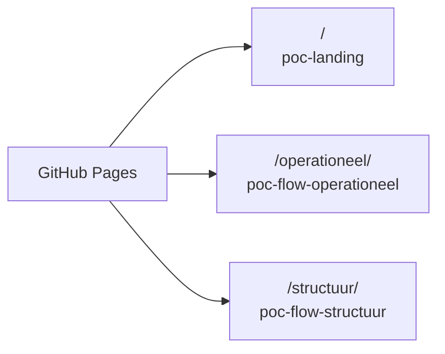

# RIE-IEPR operational schema-table POC

Editable Dutch-language reporting tables built from the same generated JSON
Schemas as the [ODS POC](../poc-json-schema-ods/docs/PROJECT_OUTLINE.md).
The former RDF-driven form is replaced by Flux **2.22.0 rich data tables**;
RDF and CSOR data still supply labels and demonstration structural references.

## Setup and development

From the repository root, prepare the generator and its snapshot:
```bash
npm --prefix poc/poc-json-schema ci
npm --prefix poc/poc-json-schema run predev
npm --prefix poc/poc-json-schema run build
npm --prefix poc/poc-json-schema run generate -- --theme Grondwater
npm --prefix poc/poc-json-schema-ods ci
cd poc/poc-flow-operationeel
pnpm install --frozen-lockfile
pnpm dev
```

The active generator reads only the groundwater reporting CSV and its supporting
choice lists, with a direct concept-scheme entry point (no `thematypes.csv`).
Strict generation remains the default; the current source generates all three
groundwater sections. `--allow-incomplete` reports blocked sections, but cannot
publish an entirely blocked snapshot. See the [generator contract](../poc-json-schema/README.md).
The Dutch [end-to-end mapping guide](../../README.md#van-csv-naar-json-schema-ui-en-ods)
explains how to interpret the CSV columns and derive the schema, form and workbook.

Dev/build hooks rebuild the linked schema runtime, verify and synchronize the
existing generated snapshot, generate matching downloadable ODS templates,
copy current RDF, and refresh CSOR labels. They do
**not** regenerate schemas or implicitly enable incomplete generation. After a
source change, regenerate SKOS and schemas first; stale/missing snapshots fail
explicitly. `pnpm sync:schemas` performs just the schema runtime build and sync.

## Editing and validation

- The schema and exported JSON are canonical: observations share `hasMember`,
  distinguished by `observedProperty`; additional characteristics share
  `additionalProperty`, distinguished by `propertyID`. Presentation annotations
  restore fixed columns, simple selections and repeated detail groups without
  introducing concept-named properties in exported JSON. The lab remains a
  `prov:Agent` under `wasAssociatedWith`, with its visible name in `label`.
  Required member/property kinds are checked independently in each owning record;
  another array item cannot satisfy a missing required kind.
- Select a production year, theme and indexed reporting section. Download
  buttons provide its blank ODS template and exact generated JSON Schema.
  Templates contain the published choice lists and fictional structural
  references from the shared examples, not the current in-memory UI draft.
  ODS workbooks use Teepak-style green headers, readable column widths and
  date formats. Dropdowns use fixed cross-sheet ranges; the `Monster` dropdown
  reads new monsternummers directly from `Monsters`. Single-cell multiselects
  allow a JSON array after confirming the spreadsheet warning.
- Singleton details are columns. A left-hand expand button opens repeated
  records (such as meetresultaten) below their owning row, spanning the full
  table width, rather than inside a column. Each detail table has its own add
  and delete actions; collapsing preserves entered values. Validation errors
  in details automatically expand the owning row.
  Scalar/reference arrays are direct multiselects:
  no ODS transport sheets, parent IDs or dimensional linking tables.
- Column headings use the source `prefLabel`. Structural containers, including
  invisible lab Agents, remain in the JSON but do not add another input prompt.
  Shared observation timestamps are entered once and materialized within their
  own reporting row during projection; optional readings are not invented.
- Conditions generated from `conditionPath`/`conditionValue` keep inactive cells
  visible, grey and disabled. Their values remain in the in-memory draft and
  return when reactivated, but are omitted from validated JSON.
- Drafts are retained separately per year and section until the page reloads.
  There is no backend or persistent storage.
- “Ingevulde ODS importeren” opens a collapsed upload panel. Its file chooser
  imports a filled template for the selected section and
  year, entirely in the browser (maximum 20 MB). The shared ODS importer verifies
  schema/source fingerprints, JSON mappings, business parent links and values
  before replacing the draft. Existing input requires confirmation; a failed
  or cancelled import leaves it intact. Imported singleton and nested records
  are editable through the same controls and validation as manually entered data.
  Workbook reference labels are retained as demonstration choices, and references
  from another reporting year are rejected. Only current generated templates
  are supported, not arbitrary or legacy spreadsheets.
  Import dependencies are loaded at startup, so the first upload does not
  trigger dependency discovery and a Vite reload.
  Regenerate/download templates after source or schema changes; matching
  filenames do not make an older workbook compatible.
- Required fields have markers. Dates and datetimes use the Flux datepicker
  (`type="date-time"` for `xsd:dateTime`). Date-time input uses the browser's
  local timezone and is stored as a UTC ISO timestamp; dates remain `YYYY-MM-DD`.
  Durations use ISO strings such as `PT1H`.
- Compact rows have an icon-only trash action with the accessible name
  “Rij verwijderen” and no visible action-column heading; keyboard users can
  activate it as a normal button. Units appear beside their numeric input in
  the same cell (fixed symbol or unit selector), without a separate unit column.
  The JSON structure and ODS unit columns remain unchanged.
- “Valideren en JSON tonen” runs the shared structural and semantic validators.
  Errors show data paths and matching cell messages; JSON appears only on success.
  Any edit clears the previous success output.
- Structural choices are explicitly fictional demonstration instances, scoped
  to the reporting year, not real reported installations or measuring points.

Blocked sections remain visible with source diagnostics instead of an invented
partial form. The browser checks source/schema SHA-256 fingerprints and compiles
the offline schema registry before editing; mismatches are visible load errors.
HTTPS/localhost uses Web Crypto; LAN HTTP uses the same SHA-256 verification
through a JavaScript implementation.

## Build and checks
```bash
pnpm build
pnpm preview
pnpm lint
pnpm test:unit
pnpm exec playwright install chromium
pnpm test
```

Playwright uses its own strict-port server on `127.0.0.1:3187` (`POC_TEST_PORT`
overrides the port), never an unrelated already-running development server.

## Deployment

The Jenkins pipeline builds this POC together with `poc-flow-structuur` and `poc-landing` and
publishes them on GitHub Pages:



The Vite build uses `base: './'`, so the assets load relatively and the build works both on GitHub
Pages (`https://milieuinfo.github.io/codelijst-rie-iepr/`) and behind any other subpath. The local
dev server keeps running at `/`.

## Data synchronisation

`pnpm dev` and `pnpm build` first run these synchronization/download steps:

- `scripts/sync-schemas.mjs` — shares the ODS snapshot-sync implementation; copies
  only indexed schemas into `public/schema/` and matching `public/codelist.jsonld`,
  verifies canonical source fingerprints and preserves incomplete diagnostics.
- `scripts/generate-downloads.mjs` — uses the ODS POC compiler/exporter to create
  blank `public/templates/` workbooks from that verified snapshot. Download paths
  derive from indexed section paths and `x-table-workbook`, not hardcoded themes.
  The templates are regenerated before dev/build; stale schema hashes or missing
  reference data fail the command instead of publishing mismatched downloads.
- `scripts/sync-codelist.mjs` — copies the generated Turtle into `public/resources/...`
  for RDF label lookup.
- `scripts/sync-csor.mjs` — downloads the CSOR lists the operationele fields refer to (eenheden,
  variabelen, kwantificeerbare aspecten, dragers en soorten waardebepaling) from GitHub and writes
  `src/generated/csor.json` with their labels, definitions and unit symbols.

CSOR is always fetched from the published GitHub repositories; a download is cached in `.cache/csor/`
as an offline fallback. Run `pnpm sync:csor` to refresh manually. The generated file is committed,
so a build without network still works (`--allow-stale`).

## Architecture Overview

See [the project outline](docs/PROJECT_OUTLINE.md) and [AGENTS.md](AGENTS.md).
`schema-snapshot.ts` loads verified schemas, `schema-editor.ts` manages drafts,
ownership/conditions and validation, `schema-lookups.ts` supplies labels and demo
references, and `schema-rich-table.ts` renders the recursive Flux tables.
The linked generator's `/browser` entry point contains no Node filesystem imports.
