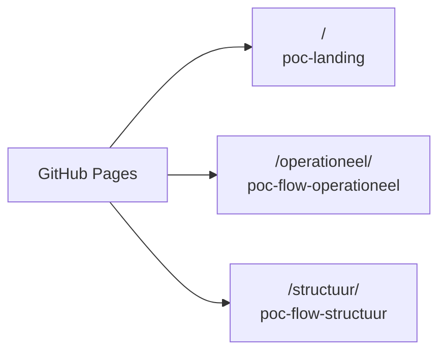

# RIE-IEPR operational schema-table POC

Editable Dutch-language reporting tables built from the same generated JSON
Schemas as the [ODS POC](../poc-json-schema-ods/docs/PROJECT_OUTLINE.md).
The former RDF-driven form is replaced by Flux **2.22.0 rich data tables**;
RDF and CSOR data still supply labels and demonstration structural references.

## Setup and development

From the repository root, prepare the generator and its snapshot:
```bash
npm --prefix poc/poc-json-schema ci
npm --prefix poc/poc-json-schema run predev
npm --prefix poc/poc-json-schema run build
npm --prefix poc/poc-json-schema run generate
npm --prefix poc/poc-json-schema-ods ci
cd poc/poc-flow-operationeel
pnpm install --frozen-lockfile
pnpm dev
```

The active generator reads the groundwater, air, water, self-control and raw-material reporting CSVs and supporting
choice lists, with direct concept-scheme entry points (no `thematypes.csv`).
Strict generation remains the default; the current source generates all three
groundwater sections, five air sections, two water sections and two self-control
sections, plus two raw-material sections: fourteen sections across six themes. Select a production year, then
`Lucht` and `Emissie` to test point/source selections, emission context and nested
pollutant results, including the matching `lucht-emissies.ods` download/import.
Choose `Verbruikte brandstof`, `Verbruikte stof`, `Geproduceerde stof` or
`Afvalproduct` for annual material reporting per installation, each with a separate
downloadable/importable ODS template. Composition is optional; fuel uses GJ and
optional 0–100% sulfur/ash. Other material quantities offer the shared seven units.
Select `Water` -> `Lozing` for annual flow/days per control point with expandable
pollutant rows, numeric measurement frequency and concentration/load results.
Its `water-lozingen.ods` template has `Waterstromen` and `Stoffen in waterstromen`
linked by the control-point selection. `Abnormale lozing` has a separate
`water-abnormale-lozingen.ods` download/import. Existing units and choice lists
are retained; water use, standalone method declarations, totals and balances
remain deferred.
Select `Zelfcontrole lucht` or `Zelfcontrole water` -> `Metingen` for point and
exact timestamp, optional lab metadata and expandable parameter results.
The paired-sheet ODS templates use point URI plus timestamp as their parent key.
Concentration, uncertainty and mass flow/water limit values are optional;
units are selectable and uncertainty is an integer 0–100 percent.
Frequency and its source are temporarily free text. Water offers three sample
types. See the [source guide](../../README.md#zelfcontrole-lucht-en-water)
for approved units, Confluence deviations and remaining pollutant/list gaps.
Select `Grondstoffen` -> `Geproduceerde grondstoffen` for the production
checkbox, material-code selection (137 choices), quantity in ton, application and
expandable destinations. Destination type activates its conditional identity
fields; switching type retains inactive drafts but excludes them from JSON.
The paired-sheet template links destinations by material-code URI.
`Inkomende grondstoffen` reports required GPBV installation, Rubriek activity,
nature and quantity in ton. Three fictional choices of each structural type
come from the shared reference snapshot, without an invented installation/activity
dependency. See the [source guide](../../README.md#grondstoffen) for remaining
precision/address/register-validation limits.
Keep `--theme` omitted during generation so all themes remain indexed.
Air is not yet Teepak-complete: emission-context material references, missing pollutant
quantities/methods and improvements remain deferred. Sources are not yet
filtered to the selected point because that relationship is not declared.
`--allow-incomplete` reports blocked sections, but cannot
publish an entirely blocked snapshot. See the [generator contract](../poc-json-schema/README.md).
The Dutch [end-to-end mapping guide](../../README.md#van-csv-naar-json-schema-ui-en-ods)
explains how to interpret the CSV columns and derive the schema, form and workbook.

The active UI and downloadable ODS templates share demonstration references from
`../poc-json-schema/examples/refs.json`, including identities, labels and types.
The UI adapts these fictional instances to the selected reporting year; it does
not generate additional choices from the legacy mock-data service. After changing
the shared examples, regenerate the personalized schemas and run `npm run sync:schemas`
to refresh the downloadable ODS lookup lists.
Feature selectors use explicit process records from that same snapshot, filtered
by their implementing system's permitted types. The process has exactly the
system's label, but JSON and ODS store the process URI, never the system URI.
Rubriek and reference-point properties remain ordinary structural selections.

Dev/build hooks rebuild the linked schema runtime, verify and synchronize the
existing generated snapshot, generate matching downloadable ODS templates,
copy current RDF, and refresh CSOR labels. They do
**not** regenerate schemas or implicitly enable incomplete generation. After a
source change, regenerate SKOS and schemas first; stale/missing snapshots fail
explicitly. `pnpm sync:schemas` performs just the schema runtime build and sync.

## Editing and validation

- The schema and exported JSON are canonical: observations share `hasMember`,
  distinguished by `observedProperty`; additional characteristics share
  `additionalProperty`, distinguished by `propertyID`. Presentation annotations
  restore fixed columns, simple selections and repeated detail groups without
  introducing concept-named properties in exported JSON. The lab remains a
  `prov:Agent` under `wasAssociatedWith`, with its visible name in `label`.
  Required member/property kinds are checked independently in each owning record;
  another array item cannot satisfy a missing required kind.
  Input controls read reference enums from the personalized presentation schema,
  rather than building a second type-based choice list. Structural validation
  uses the same personal schema; semantic validation still checks actual selected
  parents, shared observation context and other cross-field rules.
  Source-authored `referenceParent`/`referenceRelation` dependencies additionally
  filter structural dropdowns against the actual parent selection in that row.
  Connection data comes from the supplied reference snapshot's predicate-keyed
  `relations`, not from `vervolgstap`. Changing the parent preserves an invalid
  child draft for correction; validation never silently substitutes a choice.
  Conditional source fields respect the complete `_ui_after` chain and follow
  their trigger, rather than being moved to the end of the form.
- Select a production year, theme and indexed reporting section. Download
  buttons provide its blank ODS template, exact **generic JSON Schema**, and
  a **personal JSON Schema** for the selected year/current reference snapshot.
  The personal download contains real `enum` constraints plus embedded labels
  and reference context; standard offline validators can reject unknown,
  wrong-type and wrong-year URI choices without loading external reference data.
  It is rebuilt when year/section changes or an ODS import replaces the editor.
  Templates contain the published choice lists and fictional structural
  references from the shared examples, not the current in-memory UI draft.
  ODS workbooks use Teepak-style green headers, readable column widths and
  date formats. Dropdowns use fixed cross-sheet ranges; the `Monsternummer` dropdown
  reads new monsternummers directly from `Monsters`. Single-cell multiselects
  allow a JSON array after confirming the spreadsheet warning.
- Singleton details are columns. A left-hand expand button opens repeated
  records (such as meetresultaten) below their owning row, spanning the full
  table width, rather than inside a column. Each detail table has its own add
  and delete actions; collapsing preserves entered values. Validation errors
  in details automatically expand the owning row.
  Scalar/reference arrays are direct multiselects:
  no ODS transport sheets, parent IDs or dimensional linking tables.
- Column headings use the source `prefLabel`. Structural containers, including
  invisible lab Agents, remain in the JSON but do not add another input prompt.
  Shared observation timestamps are entered once and materialized within their
  own reporting row during projection; optional readings are not invented.
- Conditions generated from `conditionPath`/`conditionValue` keep inactive cells
  visible, grey and disabled. Their values remain in the in-memory draft and
  return when reactivated, but are omitted from validated JSON.
- Drafts are retained separately per year and section until the page reloads.
  There is no backend or persistent storage.
- “Ingevulde ODS importeren” opens a collapsed upload panel. Its file chooser
  imports a filled template for the selected section and
  year, entirely in the browser (maximum 20 MB). The shared ODS importer verifies
  schema/source fingerprints, JSON mappings, business parent links and values
  before replacing the draft. Existing input requires confirmation; a failed
  or cancelled import leaves it intact. Imported singleton and nested records
  are editable through the same controls and validation as manually entered data.
  Workbook reference labels are retained as demonstration choices, and references
  from another reporting year are rejected. Only current generated templates
  are supported, not arbitrary or legacy spreadsheets.
  Import dependencies are loaded at startup, so the first upload does not
  trigger dependency discovery and a Vite reload.
  Regenerate/download templates after source or schema changes; matching
  filenames do not make an older workbook compatible.
- Required fields have markers. Dates and datetimes use the Flux datepicker
  (`type="date-time"` for `xsd:dateTime`). Date-time input uses the browser's
  local timezone and is stored as a UTC ISO timestamp; dates remain `YYYY-MM-DD`.
  Durations use ISO strings such as `PT1H`.
- Compact rows have an icon-only trash action with the accessible name
  “Rij verwijderen” and no visible action-column heading; keyboard users can
  activate it as a normal button. Units appear beside their numeric input in
  the same cell (fixed symbol or unit selector), without a separate unit column.
  The JSON structure and ODS unit columns remain unchanged.
- “Valideren en JSON tonen” runs the shared structural and semantic validators.
  Errors show data paths and matching cell messages; JSON appears only on success.
  JSON and Turtle are shown in tabs, with syntax highlighting for JSON. Turtle
  can also be downloaded; RDF mapping errors are reported separately while
  retaining valid JSON. Any edit clears both outputs.
- Turtle reporting resources use the ontology's Hydra URI templates, including
  creation and submission timestamps; constructed features also include their
  production year. The POC simulates submission at validation time: its
  `dct:issued` and `dct:created` values are the current time, and every
  validation mints new UUIDs. These URIs and timestamps do not represent real
  submissions or persistent backend records. Directly selected processes retain
  their existing reference URIs. Run `npm run sync:uri-templates` after changing
  the sibling RIE-IEPR ontology's templates.
- The static ODS download retains the indexed generic schema/transport contract.
  Upload checks that contract first, then rebuilds the personal form schema with
  the imported reference labels. Separately generated personal-schema ODS files
  use their own schema fingerprints and are imported through the matching ODS
  CLI/API plan, not silently treated as generic UI templates.
- Structural choices are explicitly fictional demonstration instances, scoped
  to the reporting year, not real reported installations or measuring points.

The Turtle exporter uses the schema predicates and class annotations, constructs
annual features from the selected processes (or connecting
transport processes), and carries CSOR qualifiers and selected variables as direct
vocab predicates on results. The UI's process graph and all its
connections are **fictional**; production integration must provide a real graph.
Missing processes, ambiguous transport paths and observations without required features or
results produce errors rather than invented data. The browser does not run SHACL:
the example-based tests validate offline against the regenerated ontology shapes.

For SHACL tests install `python3 -m pip install -r test/requirements-shacl.txt`.
To refresh the snapshot after changing the sibling RIE-IEPR ontology, run
`mvn exec:java@oddtoolkit-shacl` there and `npm run sync:shacl` here. The sync
normalizes ODDToolkit's `xsd:int` cardinalities to SHACL's required `xsd:integer`;
it does not weaken the constraints.

### Offline linked-data relationship gate

The separate integration suite exports the actual reporting examples through
`exportTurtle` and validates them with **ld-mcp-vocab 0.4.2**, the supplied
RIE-IEPR ontology, and the **SOSA 2023** rules from `oslo-ld-kit`.
It does not run in the browser or depend on an MCP client.

From this POC directory, with Java 21 or newer:

```bash
npm run setup:linked-data
npm run test:linked-data
```

Setup downloads the validator, rules (including their MIT licence) and vocabulary
snapshots into the ignored `.cache/linked-data/` directory. Every download and
every test run verifies the SHA-256 values in `test/linked-data.lock.json`.
Setup needs network access only for missing files; the tests run entirely offline.
Do not delete or bypass a checksum to accept an upstream update: review and pin
the new content explicitly.

The gate checks vocabulary existence and roles, invalid literals, deprecated
terms, class disjointness after domain/range/subproperty inference, RIE-IEPR
cardinalities and SOSA rules. Project shapes additionally check collection member
types, result ownership and conflicting shared collection context (scalar values
and resource references, not containment of temporal intervals). SHACL sees
asserted data plus ontology class hierarchies and types of referenced terms;
inferred triples cannot fill in missing required data. Negative regressions
prove that broken result links, a Sample as an observation member, unknown
predicates and inferred Activity/Entity conflicts are rejected. A positive
regression checks inherited collection properties for generic SOSA observations
and RIE-IEPR subclass targets. The RIE-IEPR application profile is stricter:
every `riepr:Observatie` must have exactly one direct `sosa:observedProperty`.
A separate negative regression proves that a property on its collection alone
does not satisfy that restriction.

`test/fixtures/linked-data/` contains the exact RIE-IEPR ontology snapshot and
shapes generated **only from that ontology's restrictions**. The reused
vocabularies supply semantic context; their OWL existential restrictions are not
automatically treated as additional mandatory reporting fields. This deliberately
avoids requiring redundant inverse triples merely because an imported vocabulary
describes them. The generated shapes list the four unsupported OWL expressions;
this is not full OWL consistency checking.

Refresh that snapshot explicitly after an ontology change:

```bash
npm run sync:linked-data -- /path/to/RIE-IEPR/src/main/resources/be/vlaanderen/omgeving/riepr/data/ns/riepr/riepr.ttl
npm run test:linked-data
```

Without an argument, sync uses the sibling `RIE-IEPR` checkout. It updates the
ontology, generated shapes and their provenance/checksums together; commit all
three. Ordinary test runs never read a sibling checkout.

The current coverage is fourteen exportable sections across six themes,
including water use and incoming raw materials. A coverage assertion detects
new active sections without fixtures. Produced raw materials
(`Grondstoffen/grondstof`) are explicitly not certified: their observations still
lack a feature mapping. The root-level production flag is UI-only and is omitted
from Turtle. The exporter recognizes boolean controls without an RDF predicate
that are explicitly referenced by schema visibility conditions; it does not
silently discard arbitrary unmapped fields. This gate concerns operational data,
not the structural POC.

**Current findings:** all fourteen covered exports pass the blocking checks.
The previously missing `sosa:observedProperty` values are now declared explicitly
in the CSVs and included in the canonical examples; the exporter does not invent
them. Non-blocking diagnostics include
`sosa:Result`, `ssn:System` and `ssn:implementedBy` deprecations, and missing
recommended sensor/procedure information. Warnings are printed and retained,
not treated as proof of full conformance.

The fixed measurement-property mappings are declared in the `observedProperty`
column on the owning observation concepts, not on their result containers:

| Observation concept | `observedProperty` |
|---|---|
| `grondwater:peilmeting` | `grondwater:peilmeting-diepte` |
| `lucht:verbruikte_stof` | `lucht:verbruikte_stof_hoeveelheid` |
| `lucht:geproduceerde_stof` | `lucht:geproduceerde_stof_hoeveelheid` |
| `lucht:afvalproduct` | `lucht:afvalproduct_hoeveelheid` |
| `grondstoffen:inkomend` | `grondstoffen:inkomend_hoeveelheid` |
| `grondstoffen:grondstof` (not yet certified) | `grondstoffen:grondstof_hoeveelheid` |

`operationeel_grondwater.csv`, `operationeel_lucht.csv` and
`operationeel_grondstoffen.csv` contain these mappings. The new grondstoffen
column is immediately before `_ui_after`, matching the groundwater column order.
The existing schema compiler already turns this metadata into a required,
hidden URI constant; the editor materializes it when projecting a report.
No new input control or POC code is needed for these mappings. Source changes
still require validation, schema regeneration and consumer synchronization.
Canonical example JSON must also carry the constants: exporting raw JSON does
not insert missing schema constants.

The raw export report is `.cache/linked-data/report.json`; its companion `.log`
contains validator diagnostics, and `exports/` contains the validated Turtle.
Intentional negative cases have a separate `regression-report.json` and
`regressions/` directory. The command exits nonzero for data errors, parse/configuration
errors, missing context or failed integrity checks. It is separate from
`test:unit` and is **not yet wired into Jenkins**; a CI job needs Java, the POC's
normal Node dependencies, setup and this command, and should archive those reports
even on failure. HTTP dereferenceability, persistent production identifiers and
business correctness beyond the declared shapes remain outside this offline gate.

Blocked sections remain visible with source diagnostics instead of an invented
partial form. The browser checks source/schema SHA-256 fingerprints and compiles
the offline schema registry before editing; mismatches are visible load errors.
HTTPS/localhost uses Web Crypto; LAN HTTP uses the same SHA-256 verification
through a JavaScript implementation.

## Build and checks
```bash
pnpm build
pnpm preview
pnpm lint
pnpm test:unit
pnpm exec playwright install chromium
pnpm test
```

Playwright uses its own strict-port server on `127.0.0.1:3187` (`POC_TEST_PORT`
overrides the port), never an unrelated already-running development server.

## Deployment

The Jenkins pipeline builds this POC together with `poc-flow-structuur` and `poc-landing` and
publishes them on GitHub Pages:



The Vite build uses `base: './'`, so the assets load relatively and the build works both on GitHub
Pages (`https://milieuinfo.github.io/codelijst-rie-iepr/`) and behind any other subpath. The local
dev server keeps running at `/`.

## Data synchronisation

`pnpm dev` and `pnpm build` first run these synchronization/download steps:

- `scripts/sync-schemas.mjs` — shares the ODS snapshot-sync implementation; copies
  only indexed schemas into `public/schema/` and matching `public/codelist.jsonld`,
  verifies canonical source fingerprints and preserves incomplete diagnostics.
- `scripts/generate-downloads.mjs` — uses the ODS POC compiler/exporter to create
  blank `public/templates/` workbooks from that verified snapshot. Download paths
  derive from indexed section paths and `x-table-workbook`, not hardcoded themes.
  The templates are regenerated before dev/build; stale schema hashes or missing
  reference data fail the command instead of publishing mismatched downloads.
- `scripts/sync-codelist.mjs` — copies the generated Turtle into `public/resources/...`
  for RDF label lookup.
- `scripts/sync-csor.mjs` — downloads the CSOR lists the operationele fields refer to (eenheden,
  variabelen, kwantificeerbare aspecten, dragers en soorten waardebepaling) from GitHub and writes
  `src/generated/csor.json` with their labels, definitions and unit symbols.

CSOR is always fetched from the published GitHub repositories; a download is cached in `.cache/csor/`
as an offline fallback. Run `pnpm sync:csor` to refresh manually. The generated file is committed,
so a build without network still works (`--allow-stale`).

## Architecture Overview

See [the project outline](docs/PROJECT_OUTLINE.md) and [AGENTS.md](AGENTS.md).
`schema-snapshot.ts` loads verified schemas, `schema-editor.ts` manages drafts,
ownership/conditions and validation, `schema-lookups.ts` supplies labels and demo
references, and `schema-rich-table.ts` renders the recursive Flux tables.
The linked generator's `/browser` entry point contains no Node filesystem imports.
