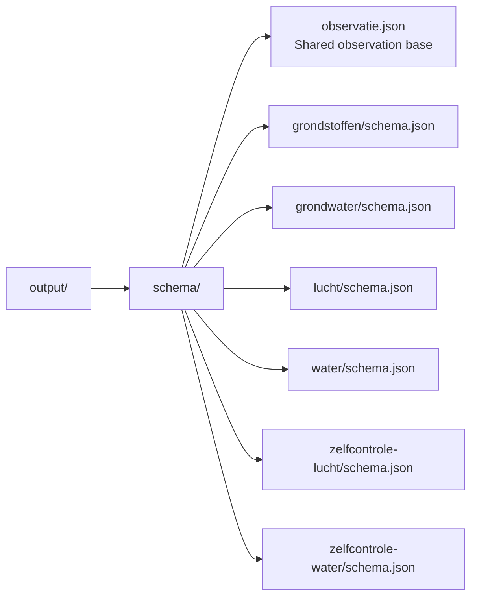

# Project Outline — RIE-IEPR Codelist-to-JSON-Schema POC

## Current status: shared groundwater reporting contract

The implemented generator compiles the groundwater source CSV and supporting
lists into JSON Schema Draft 2020-12. Its three reporting sections are consumed
by both the operational UI and reversible ODS workbooks. Neither consumer
reconstructs the reporting model independently from RDF.

The [Dutch mapping guide](../../../README.md#van-csv-naar-json-schema-ui-en-ods)
explains the transformation column by column. The [package README](../README.md)
documents generation, snapshot provenance, validation and commands.

| Concern | Active contract |
|---|---|
| Entry and scope | Direct `conceptscheme:operationeel_grondwater`; no theme-list dependency or other operational CSVs |
| Sections | Onttrekking and kwaliteitsmeting are collections; peilmeting is an observation |
| Ownership | `broaderPartitive` establishes source groups; `relevantObservation` assigns semantic owners independently of presentation |
| Predicates | Real declared relations; missing nested relations block generation except explicit feature inputs |
| Members | One `hasMember` array with `observedProperty` variants |
| Additional characteristics | One `additionalProperty` array of PropertyValues identified by `propertyID` |
| Required variants | `contains` cardinalities on each discriminator, plus required fields inside each object |
| Laboratory | `wasAssociatedWith` to a `prov:Agent` with `label`; no invented Sample/Sampling layer |
| Numeric observations | Implicit typed Resultaat with numeric value and declared unit |
| Shared dates | One visible source copied to existing targets in the same record; conflicts fail |
| Presentation | Source labels, hidden containers, order and workbook/sheet annotations survive canonical grouping |
| Consumers | Shared canonical/presentation data and path mappings; structural and semantic validation |
| Output provenance | Indexed source/schema fingerprints; stale snapshots and incompatible workbooks are rejected |

Generation does not invent units, choices, predicates or missing domain facts.
Feature construction, full RDF serialization and persistent storage are outside
the POC. Current groundwater examples and generated ODS are round-trip checked.

## Historical planning notes (superseded)

Everything below preserves the initial multi-theme proposal, not the current
architecture, source inventory or acceptance criteria. In particular, remote
schema dependencies, unresolved-list fallbacks and `seeAlso` entry discovery
are not the active contract. Use the current guides linked above.

---

## Goal

Produce a Node.js-based transformation tool that:

1. Reads the RIE-IEPR codelist JSON-LD file
2. Parses SKOS conceptschemes and concepts using the declared properties
3. Maps codelist metadata to JSON Schema constructs
4. Generates a base `observatie.json` schema and per-theme domain schemas (e.g., `lucht/schema.json`, `water/schema.json`)
5. Outputs valid Draft 2020-12 JSON Schemas with `$ref` composition

The output should match the structure and intent of the manually-created schemas in `docs/archive/`:

| Archive File | Purpose |
|---|---|
| `archive/observatie.json` | Base observation schema extending SOSA OGC API properties with Dutch labels and common fields (`resultTime`, `observedProperty`, `hasFeatureOfInterest`, `wasOriginatedBy`, `hasResult`) |
| `archive/lucht/schema.json` | Domain-specific schema for "Lucht" theme constraining `observedProperty` to air-quality enums, adding conditional validation rules via `if/then` blocks |

---

## Codelist Interpretation Model

The original specification referred to the root [`README.md`](../../../README.md), section **"Interpretatie"**. The following table records the historical proposal:

| Codelist Property | JSON Schema Mapping | Notes |
|---|---|---|
| `relevantDataType` | `type` / `format` | `xsd:string` → `"string"`, `xsd:boolean` → `"boolean"`, `xsd:decimal` → `"number"`, `xsd:date` → `"string"/"date"`, `xsd:dateTime` → `"string"/"date-time"` |
| `isVerplicht` | `required[]` | When `"true"`, add property key to parent's `required` array |
| `relevantCodeList` | `enum` of concept IDs | Resolved against local schemes (top concepts) and `skos:Collection`s (members, e.g. CSOR variabelen); unresolvable refs produce empty enum (documented issue) |
| `kwantiteitsAspect` / `drager` / `soortWaartbepaling` | `x-kwantiteitsaspect` / `x-drager` / `x-soortwaardebepaling` | CSOR URIs describing what a value field measures (e.g. massaconcentratie in water, standaard) |
| `variabele` | `x-variabele` | Property name of the sibling stof field whose selected CSOR variabele the value is about |
| `relevantUnit` | Direct value for `hasResult.hasUnit` | Single unit → `const` with URI; multiple units → `enum` of URIs; selected unit becomes hasUnit value directly |
| `conditionPath` + `conditionValue` | `if/then` conditional validation | Field shown only when trigger field matches value |
| `minValue` / `maxValue` | `minimum` / `maximum` on numeric fields | Declared in context.json but columns missing from most CSVs (ISSUE-COLLECTION-01) |
| `broader` / `narrower` | Nested object via `properties` | Composite concepts group children under parent as sub-object |
| `isMeervoudig` | `type: "array"` with `items` | Repeatable composite or field — 23 concepts use this across all schemes |
| `seeAlso` | Multi-level observation generation | Each level of the chain produces its own Observation schema; innermost = primary measurement |
| `relevantClass` | Sub-schema / collection envelope | `riepr:Observatie` (or `sosa:Observation`) composites become observation sub-schemas, `riepr:ObservatieVerzameling` (or `sosa:ObservationCollection`) composites become collection envelopes (see `config.ts`) |
| `relevantRiepr` | Placeholder IRI reference | Dynamic database lookup — transformation uses placeholder URIs with descriptive metadata |

---

## Thematic Streams and Operationeel Schemes

Six thematic streams exist in `conceptscheme:thema_type`. Each resolves to one or more operational schemes via `seeAlso`:

| Theme | Base Scheme | Sub-Scheme(s) via seeAlso Chain | Root Fields | Notes |
|---|---|---|---|---|
| Grondstoffen | `operationeel_grondstoffen` | — | 7 | Boolean gate (geproduceerd) controls visibility of grondstof composite |
| Grondwater | `operationeel_grondwater` | — | ~14 | Composite groups: peilmeting, kwaliteitsmeting, onttrekking; conditional fields on pomptoestand |
| Lucht | `operationeel_lucht` | `operationeel_lucht_bron` → `operationeel_lucht_rapportering` | 2 (emissiepunt + bronnen) | Multi-step flow: emissiepunt → bronnen (isMultiselect) → rapportering fields |
| Water | `operationeel_water` | `operationeel_water_lozing` | 1 (controleinrichting) | Chains to loizing scheme with verontreinigende_stof details |
| Zelfcontrole lucht | `operationeel_zelfcontrole_lucht` | `operationeel_zelfcontrole_lucht_meting` | — | Meting sub-scheme with datum, labo, parameter composites |
| Zelfcontrole water | `operationeel_zelfcontrole_water` | `operationeel_zelfcontrole_water_meting` | 1 (controleinrichting) | Mirrors zelfcontrole_lucht structure for water domain |

---

## Transformation Design Principles

### Minimal Application/Business Logic

This POC is a **data-driven transformation**, not an application. The pipeline should contain minimal business logic:

- **DO**: Parse codelist properties declaratively and map them 1:1 to JSON Schema constructs
- **DO**: Handle structural composition (broader/narrower grouping, seeAlso chaining) as mechanical transformations
- **DON'T**: Encode validation rules that aren't present in the source data (e.g., min/max ranges, pattern constraints)
- **DON'T**: Make assumptions about value semantics beyond what the codelist declares
- **DON'T**: Implement UI rendering, form state management, or user interaction logic

Any missing business logic needed for meaningful schemas (value ranges, patterns, derived validations) must be documented in [`docs/ISSUES.md`](./ISSUES.md).

### Output Structure

The transformation tool should accept a `--theme` flag to generate a single theme's schema, or run without arguments to generate all.

---

## Known Data-Quality Gaps

Several codelist properties reference external or unresolved resources. These are tracked in detail in [`docs/ISSUES.md`](./ISSUES.md). Summary:

- **No min/max/range constraints** — The archived `lucht/schema.json` has `"minimum": 0, "maximum": 100` for relative humidity, but no such constraints exist in the source data
- **8 fields with `relevantUnit = http://TODO`** — Unit information is missing entirely
- **14 fields with unresolvable `relevantCodeList` refs** — External domains (`vito.be`), placeholder URIs (`http://TODO`), or non-local prefixes (`conceptscheme-alg:`)
- **No pattern/format validation rules** — Only basic type mapping via `relevantDataType`
- **Only 1 concept uses `isMultiselect`** — `Bron(nen)` in `operationeel_lucht_bron`

These gaps mean the generated schemas will be structurally correct but lack semantic validation depth. This is by design — the POC demonstrates the transformation mechanism, not a complete production validator.

---

## Guardrails

- **Standalone project**: No imports from `poc-flow-operationeel`. Copy only infrastructure (sync script, package skeleton).
- **Draft 2020-12**: Generated schemas must conform to JSON Schema Draft 2020-12 specification.
- **$ref composition**: Use remote `$ref` URLs following the pattern `https://data.riepr.omgeving.vlaanderen.be/schema/2026/...` matching the archived examples.
- **Content-agnostic parsing**: The codelist parser should not special-case any scheme name or property value. New themes added upstream should require zero code changes.
- **Dutch labels**: All `title` and `description` fields in generated schemas must use Dutch text from `prefLabel` and `definition`.
- **No persistence**: The tool reads a file and writes files. No database, no API calls beyond fetching the local codelist.

---

## Tech Stack

Same as `poc-flow-operationeel`:

- **Node.js** — Runtime for the transformation CLI/tool
- **TypeScript** — Static typing for models and services
- **No web framework needed** — This is a build-time transformation, not a running web app

The output is purely JSON files. Validation of generated schemas can be done with `ajv` (JSON Schema validator) as part of tests.

---

## Tasks

Detailed actionable tasks are documented below. Each task follows the same format as used in `poc-flow-operationeel`: numbered sequentially with a clear title, description, scope, and Definition of Done (DOD).

See individual task descriptions linked above.
