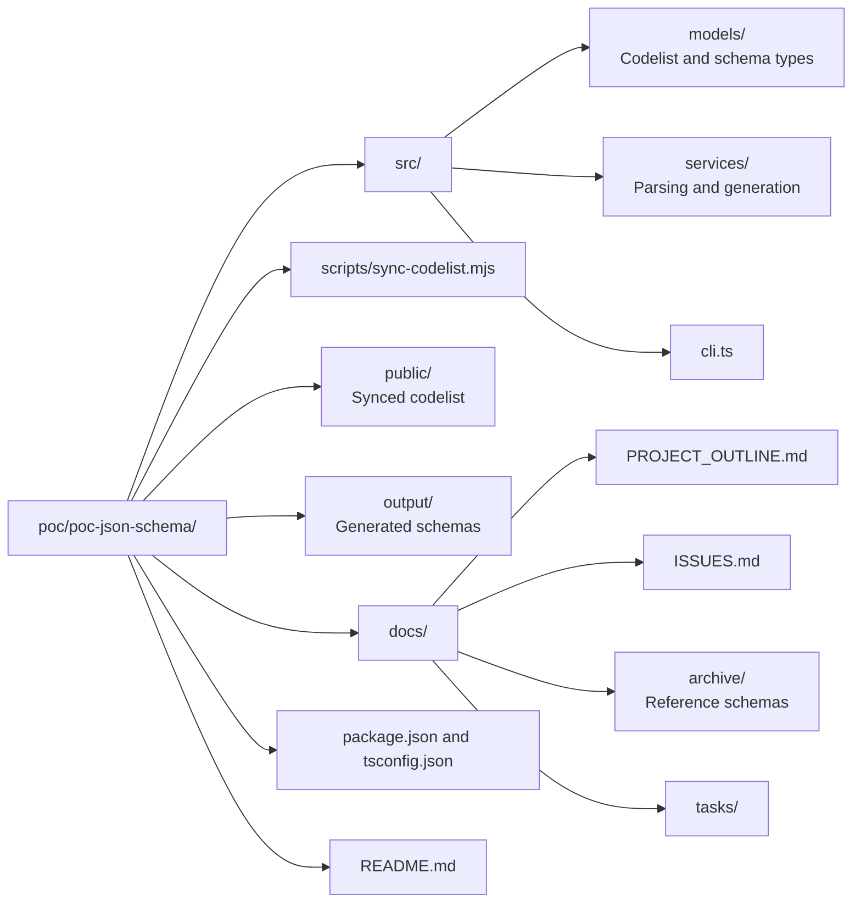

# Task 01 — Project Scaffolding

Set up the Node.js/TypeScript project skeleton for the transformation tool. This is a build-time CLI
tool, not a running web app. No Vite, no Lit components, no browser runtime needed.

## Scope

### Directory Structure



### Package Configuration (`package.json`)

- **name**: `codelijst-rie-iepr-poc-json-schema`
- **type**: `"module"` (ESM)
- **scripts**:
  - `predev`: sync codelist (copy from upstream)
  - `build`: `tsc` — compile TypeScript to JS
  - `generate`: `node dist/cli.js` — run the transformation
  - `test`: `vitest run` — unit tests
- **Dependencies** (minimal):
  - No UI libraries needed
  - Dev: `typescript`, `vitest`, `@types/node`, optional `ajv` for schema validation in tests

### Sync Script

Copy `scripts/sync-codelist.mjs` from `poc-flow-operationeel/scripts/sync-codelist.mjs` with path
adjustments. The script copies `rie-iepr.jsonld` from the parent project's source directory into
`public/resources/be/vlaanderen/omgeving/data/id/conceptscheme/rie-iepr/`.

Adjust paths:
- `pocRoot` resolves one level up from `scripts/`
- `repoRoot` resolves two levels up from `pocRoot` (same as flow-operationeel since both POCs are siblings)
- Destination: `public/resources/be/vlaanderen/omgeving/data/id/conceptscheme/rie-iepr/rie-iepr.jsonld`

### TypeScript Configuration (`tsconfig.json`)

```jsonc
{
  "compilerOptions": {
    "target": "ES2022",
    "module": "NodeNext",
    "moduleResolution": "NodeNext",
    "outDir": "./dist",
    "rootDir": "./src",
    "strict": true,
    "esModuleInterop": true,
    "skipLibCheck": true,
    "declaration": true,
    "resolveJsonModule": true
  },
  "include": ["src/**/*.ts"],
  "exclude": ["node_modules", "dist", "output"]
}
```

## Deliverables

1. `package.json` with correct dependencies and scripts
2. `tsconfig.json` configured for Node.js ESM output
3. `scripts/sync-codelist.mjs` working correctly
4. Directory structure created per the layout above
5. `README.md` with basic project description and usage instructions
6. Empty placeholder files: `src/cli.ts`, `src/models/index.ts`, `src/services/index.ts`

## Definition of Done

- `npm install` completes without errors
- `npm run predev` copies the codelist file from upstream successfully
- `npm run build` compiles empty TypeScript skeleton to `dist/` without errors
- `npx tsc --noEmit` passes with zero errors
- Running `node dist/cli.js` prints a placeholder message (e.g., "JSON Schema generator — v0.1.0")
